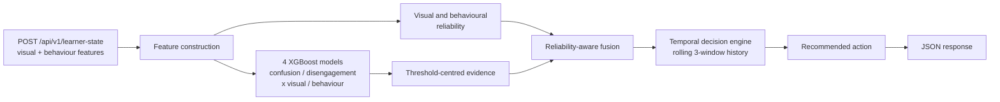

# MindBridge — Learner State (component documentation)

> **Read this file first.** These documents describe ONE component of a four-person research
> project: **Learner-Specific Reliability-Aware Multimodal Fusion for Adaptive Learning Support**.
> Everything here is based on the code under `backend/app/learner_state/`, its tests, and the
> trained model files committed in the repository.

## 1. Purpose

MindBridge is an adaptive learning app for Sri Lankan Grade 4–5 scholarship-exam learners. While a
learner works through a task, the app needs to know whether the learner is struggling or
losing focus, so that the tutoring component can respond at the right time.

The learner-state component answers two questions for every short time window of a learning
session:

| Question | Learner state | Possible support signal |
| --- | --- | --- |
| Is the learner **confused**? | `no_confusion`, `transient_confusion`, `productive_confusion`, `intervention_worthy_confusion`, `recovering_from_confusion`, `uncertain` | `request_tutor_support` |
| Is the learner **disengaged**? | `engaged`, `transient_disengagement`, `persistent_disengagement`, `recovering_engagement`, `uncertain` | `request_reengagement_support` |

It then combines both answers into one `recommended_action` for the rest of the system.

## 2. Core idea: reliability-aware multimodal fusion

Two independent kinds of evidence are available:

- **Visual evidence**: derived webcam features such as eye openness, gaze ratio, head pose and face
  visibility. The component never receives raw video frames.
- **Behavioural evidence**: interaction features such as correctness, hint use, attempts and
  response time.

Neither source is always trustworthy. A turned-away face makes visual evidence weak; a missing
field, an extreme response time or a very short learner history makes behavioural evidence weak.
The component therefore:

1. computes a **reliability score** (0–1) for each modality for the current window,
2. gives each modality a fusion weight proportional to its reliability,
3. lowers the **fusion confidence** when two reliable modalities disagree, and
4. uses a short **temporal history** so that one noisy window does not trigger an intervention.

## 3. Pipeline overview



The same pipeline runs twice per window: once for confusion and once for disengagement.

## 4. Status of the work

These three levels must be kept separate in reports and presentations:

| Level | Status |
| --- | --- |
| **Implemented prototype** | Done. The full pipeline above runs in the FastAPI backend behind `POST /api/v1/learner-state`. |
| **Unimodal models** | Four XGBoost models trained separately on public datasets (DAiSEE for visual, ASSISTments for behavioural). Each model was evaluated on its own dataset only. |
| **Multimodal validation** | **Not done yet.** DAiSEE and ASSISTments are not synchronized, so the fusion and temporal rules cannot be validated on them. This needs synchronized MindBridge pilot data. |

The fusion weights, reliability rules and temporal thresholds are design decisions. They are
**not** yet validated on real learners.

## 5. Document map

| File | Contents |
| --- | --- |
| `00_README.md` | This file: purpose, pipeline overview, status |
| [`01_ARCHITECTURE.md`](01_ARCHITECTURE.md) | Clean Architecture layers, module responsibilities, request flow, in-memory session state |
| [`02_DATA_AND_FEATURES.md`](02_DATA_AND_FEATURES.md) | Visual features, behavioural features, learner-history features, dataset notes |
| [`03_MODEL_INFERENCE.md`](03_MODEL_INFERENCE.md) | The four XGBoost models, loading, feature-order checks, thresholds, threshold-centred evidence |
| [`04_RELIABILITY_AND_FUSION.md`](04_RELIABILITY_AND_FUSION.md) | Visual and behavioural reliability, weighted fusion, disagreement and fusion confidence |
| [`05_TEMPORAL_DECISION_ENGINE.md`](05_TEMPORAL_DECISION_ENGINE.md) | Rolling history, confusion and disengagement states, support decisions, action priority |
| [`06_API_SPEC.md`](06_API_SPEC.md) | `POST /api/v1/learner-state` request, response, errors and examples |
| [`07_EVALUATION_AND_LIMITATIONS.md`](07_EVALUATION_AND_LIMITATIONS.md) | What has and has not been evaluated, limitations, privacy and ethics |
| [`08_IMPLEMENTATION_AND_TESTING.md`](08_IMPLEMENTATION_AND_TESTING.md) | Build order, module interaction, tests, developer commands |

## 6. Code map

```text
backend/app/learner_state/
├── api/
│   ├── router.py                 # POST /learner-state, request -> service -> response
│   └── schemas.py                # Pydantic request/response models
├── application/
│   └── service.py                # LearnerStateService: orchestration + in-memory session history
├── domain/
│   ├── confusion.py              # confusion pipeline for one window
│   ├── disengagement.py          # disengagement pipeline for one window
│   ├── fusion.py                 # threshold-centred evidence + reliability-aware fusion
│   └── temporal.py               # temporal state decisions
└── infrastructure/
    ├── feature_builder.py        # behavioural + learner-history features
    ├── model_loader.py           # XGBoost loading, feature-order validation, prediction
    ├── reliability.py            # visual and behavioural reliability
    └── models/                   # four trained XGBoost JSON model files
```

## 7. Glossary

| Term | Meaning |
| --- | --- |
| Window | One short segment of a learning session, identified by an increasing `window_id`. One API request = one window. |
| Session | All windows with the same (`session_id`, `learner_id`) pair. |
| Modality | One source of evidence: visual or behavioural. |
| Probability | Raw output of one XGBoost model (0–1). |
| Evidence | Probability rescaled so the model's decision threshold maps to 0.5. |
| Reliability | How trustworthy one modality's input is for the current window (0–1). |
| Fused evidence | Reliability-weighted combination of visual and behavioural evidence. |
| Fusion confidence | How much the fused evidence should be trusted, after penalising disagreement. |
| Support need | What one detector (confusion or disengagement) asks the system to do. |
| Recommended action | The single action chosen from both support needs. |
