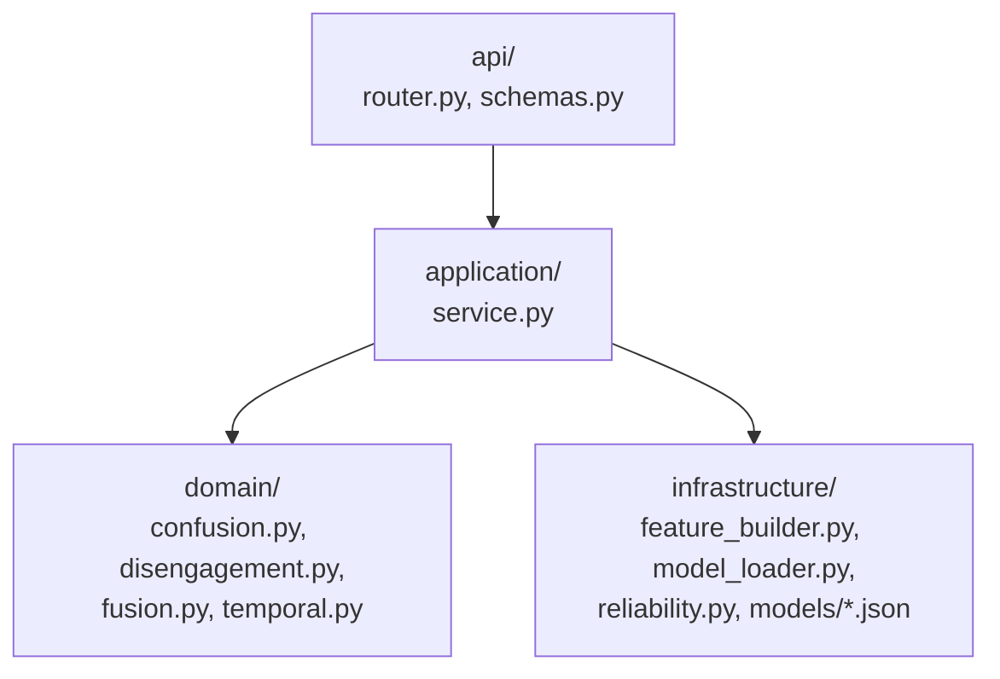
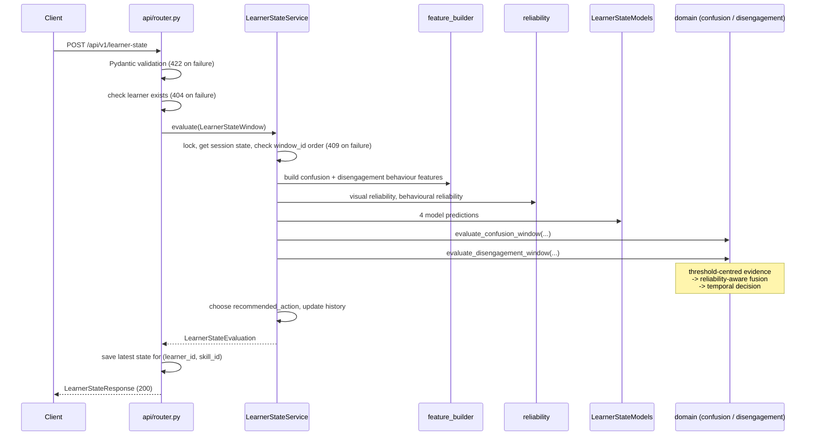

# 01 — Architecture

## 1. Place in the MindBridge backend

MindBridge is a modular monolith (see [`docs/architecture.md`](../architecture.md)). The
learner-state component is one research module inside the single FastAPI application:

```text
backend/app/
├── main.py                 # registers learner_state router under /api/v1
├── shared/learner/         # shared learner identity (learner_id UUID)
├── knowledge_tracing/      # teammate module
├── learner_state/          # THIS component
├── adaptive_tutor/         # teammate module
└── gamification/           # teammate module
```

`backend/app/main.py` registers the router:

```python
app.include_router(learner_state_router, prefix=settings.api_v1_prefix)  # "/api/v1"
```

The module uses the shared learner identity (`learner_id`) and the shared learner service to check
that a learner exists. It does not import any other research module. It owns one database table,
`learner_skill_states` (see §6), linked to `learners.id`. It does not add anything to the shared
`learners` table, as required by `docs/architecture.md`.

## 2. Clean Architecture layers

The module follows the same four-folder structure used across the repository.



| Layer | Files | Responsibility |
| --- | --- | --- |
| **API** | `api/router.py`, `api/schemas.py` | Validates the HTTP request with Pydantic, converts it to application objects, calls the service, converts the result to the response model, maps service `ValueError` to HTTP 409. |
| **Application** | `application/service.py`, `application/recording.py`, `application/support_need.py` | `LearnerStateService` coordinates one window end to end and keeps per-session history in memory, and chooses the final `recommended_action`. `LearnerStateRecorder` is the use case shared by HTTP and in-process callers. `support_need.py` publishes the support-need contract. |
| **Domain** | `domain/fusion.py`, `domain/temporal.py`, `domain/confusion.py`, `domain/disengagement.py` | Pure functions with no I/O and no stored state: threshold-centred evidence, reliability-aware fusion, temporal state rules. Previous history is passed in as arguments. |
| **Infrastructure** | `infrastructure/feature_builder.py`, `infrastructure/model_loader.py`, `infrastructure/reliability.py`, `infrastructure/models/` | Builds model feature dictionaries, loads XGBoost models and runs prediction, computes modality reliability from data-quality constants. |

The domain layer does not import XGBoost, FastAPI or the infrastructure layer. The application
layer is the only place that joins domain rules with infrastructure adapters.

## 3. Request flow



Step by step:

1. **API request** — `router.py` receives `LearnerStateRequest`, checks through the shared learner
   service that `learner_id` exists, and builds a `LearnerStateWindow` containing a
   `VisualObservation` and a `BehaviorObservation`. The learner check happens before evaluation, so
   an unknown learner never changes session history.
2. **Feature construction** — the service passes visual features unchanged; it builds 10 confusion
   behaviour features and 20 disengagement behaviour features (the latter using the session's
   behaviour history).
3. **Model inference** — four XGBoost models return four probabilities.
4. **Reliability calculation** — one visual reliability and one behavioural reliability value are
   computed for the window. Both detectors use the same visual reliability. The disengagement
   detector applies the learner-history factor to behavioural reliability; the confusion detector
   uses behavioural data quality only, because its model has no history features.
5. **Reliability-aware fusion** — each detector converts its two probabilities into
   threshold-centred evidence and fuses them.
6. **Temporal decision** — each detector combines the current fused evidence with up to two
   previous windows and chooses a state and support need.
7. **Support recommendation** — `_choose_recommended_action` merges both support needs into one
   action.
8. **Skill-state storage** — the router saves the latest result for (`learner_id`, `skill_id`) in
   `learner_skill_states`, including the tutor-facing support need (see
   [`09_TUTOR_HANDOFF.md`](09_TUTOR_HANDOFF.md)).
9. **API response** — the router maps the result into `LearnerStateResponse`.

## 4. The unified `LearnerStateService`

`LearnerStateService` (`application/service.py`) is the single entry point for evaluating a window.
It replaces calling the confusion and disengagement pipelines separately.

```python
class LearnerStateService:
    def __init__(self, models: LearnerStateModels | None = None) -> None: ...
    def evaluate(self, window: LearnerStateWindow) -> LearnerStateEvaluation: ...
    def clear_session(self, *, session_id: str, learner_id: UUID) -> None: ...
```

- `models` can be injected (useful for testing); by default `LearnerStateModels.load_default()`
  loads the four committed model files.
- `evaluate` runs the full flow above inside a re-entrant lock (`threading.RLock`), so concurrent
  requests in the same process do not corrupt session history.
- `clear_session` removes one session's history. It is available in the service but is **not**
  exposed through an API endpoint.

`get_learner_state_service()` (`application/recording.py`) creates the service once with
`@lru_cache`. This keeps one instance alive for the lifetime of the process, which is required for
temporal history to survive between requests. Because of this, the models are loaded on the
**first** learner-state request, not at application start-up.

### 4.1 Recording use case

`LearnerStateRecorder.record(window, skill_id=...)` (`application/recording.py`) is the
application use case that both the HTTP route and in-process callers use:

1. validates the Universal Skill ID (1–16 characters);
2. checks that the learner exists (`UnknownLearnerError` otherwise), before evaluation, so an
   unknown learner never changes session history;
3. evaluates the window with the shared `LearnerStateService` (`WindowOrderError`, a
   `ValueError`, for a duplicate or older `window_id`);
4. saves the latest state for (`learner_id`, `skill_id`) and returns the full evaluation.

Because every caller uses the same service instance, a window sent over HTTP and a window recorded
in process for the same session share one history and one `window_id` sequence. The HTTP route
maps `UnknownLearnerError` to 404 and `WindowOrderError` to 409.

## 5. Session state (in memory)

History is stored per key `(session_id, learner_id)` in a Python dictionary inside the service:

| Field | Max length | Used for |
| --- | --- | --- |
| `behavior_history` | 20 (`HISTORY_WINDOW`) | learner-history features for the disengagement behaviour model and history confidence |
| `confusion_fused`, `confusion_confidence` | 3 (`TEMPORAL_HISTORY_SIZE`) | confusion temporal decision |
| `task_progress` | 3 | productive vs intervention-worthy confusion |
| `disengagement_fused`, `disengagement_confidence` | 3 | disengagement temporal decision |
| `last_window_id` | — | rejecting duplicate or out-of-order windows |

History is updated **after** the current window is evaluated, so the current window is never part
of its own learner baseline.

Important consequences (see also [`07_EVALUATION_AND_LIMITATIONS.md`](07_EVALUATION_AND_LIMITATIONS.md)):

- All temporal history is lost when the backend restarts. (The latest result per skill is stored
  in the database, but the windows needed for the next temporal decision are not.)
- If the backend runs with several worker processes, each worker has its own separate history.
- The service docstring notes that a persistent store can replace the dictionary later without
  changing domain logic.

## 6. Stored skill state (database)

`learner_skill_states` keeps **one row per (`learner_id`, `skill_id`)**, overwritten by each new
window for that skill. It is defined in `infrastructure/db/models.py`, created by the Alembic
migration `20261014_01`, and accessed through `SqlAlchemyLearnerSkillStateRepository`.

| Column | Meaning |
| --- | --- |
| `learner_id`, `skill_id` | Primary key; `learner_id` references `learners.id`. `skill_id` is a label sent by the client, with no foreign key to another module. |
| `session_id`, `window_id`, `observed_at` | Which window produced this row; `observed_at` is the request `timestamp` |
| `confusion_state`, `confusion_support_need`, `confusion_temporal_score` | Confusion result |
| `disengagement_state`, `disengagement_support_need` | Disengagement result |
| `recommended_action` | Combined action |
| `support_need` | Tutor-facing 0–1 value; `NULL` while confusion is `uncertain` |
| `updated_at` | Set by the database |

Only the latest result is stored, not a history of windows. The application layer depends on the
`LearnerSkillStateRepository` protocol, not on SQLAlchemy.

## 7. Error handling summary

| Situation | Where | Result |
| --- | --- | --- |
| Request body fails Pydantic validation | FastAPI | HTTP 422 |
| `learner_id` does not exist in the shared learners table | router, via `LearnerService.get` | HTTP 404 |
| `window_id` not greater than the last accepted one for this session | `_validate_window_order` raises `ValueError` | HTTP 409 |

HTTP 422, HTTP 404 and HTTP 409 are the documented error responses of the endpoint. Separately, model
loading raises `FileNotFoundError` for a missing model file and `RuntimeError` for a feature-order
mismatch. The router does not map these exceptions to a response; like any unexpected unhandled
server error, they may result in HTTP 500, which is not part of the API contract.

Details are in [`06_API_SPEC.md`](06_API_SPEC.md).
