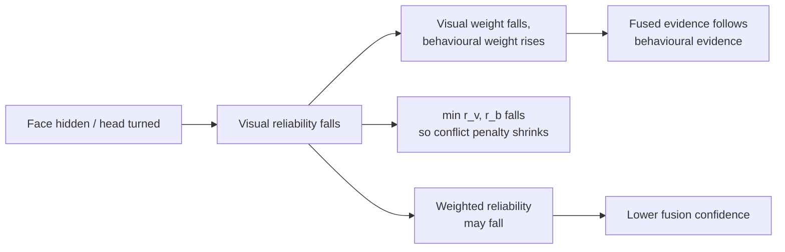

# 04 — Reliability and Fusion

Reliability answers the question: **"How much should we trust this modality's input for this
window?"** It is computed from input quality, not from the model output. Fusion then combines the
two modalities using those reliabilities.

Code:

- `infrastructure/reliability.py` — `calculate_visual_reliability`, `calculate_behavior_reliability`
- `domain/fusion.py` — `threshold_centered_evidence`, `reliability_aware_fusion`

The same visual reliability and the same behavioural reliability are used by both the confusion
and the disengagement detector in a given window.

## 1. Visual reliability

Visual evidence is weak when the face is often not visible or the head is turned far away from
the camera. Two factors are used.

### 1.1 Face visibility

```text
visibility = clip(face_visibility_ratio, 0, 1)
```

### 1.2 Head-pose quality

For each of pitch, yaw and roll, the absolute mean angle is compared with two fixed reference
values (`Q75`, `Q95`) stored in `reliability.py`:

| Dimension | Q75 | Q95 |
| --- | --- | --- |
| Pitch | 10.6009 | 18.1916 |
| Yaw | 11.3656 | 20.6081 |
| Roll | 6.3687 | 11.2431 |

```text
dimension_quality = 1 - clip( (|angle| - Q75) / (Q95 - Q75), 0, 1 )
pose_quality      = (pitch_quality + yaw_quality + roll_quality) / 3
```

So for each dimension:

- `|angle| ≤ Q75` → quality 1.0 (normal head position),
- `|angle| ≥ Q95` → quality 0.0 (extreme head position),
- in between → linear decrease.

### 1.3 Combined visual reliability

```text
visual_reliability = clip( visibility * (0.5 + 0.5 * pose_quality), 0, 1 )
```

Face visibility is a hard multiplier: no visible face means zero visual reliability. Poor head
pose can at most halve the reliability, because a turned head is still partly informative (it may
itself indicate disengagement).

| `face_visibility_ratio` | `pose_quality` | Visual reliability |
| --- | --- | --- |
| 0.95 | 1.0 | 0.95 |
| 0.95 | 0.0 | 0.475 |
| 0.50 | 1.0 | 0.50 |
| 0.00 | any | 0.00 |

## 2. Behavioural reliability

Behavioural evidence is weak when required information is missing, timing data looks invalid or
extreme, or the learner has little history in this session.

### 2.1 Data quality

Start at `data_quality = 1.0` and subtract penalties:

| Condition | Penalty | Meaning |
| --- | --- | --- |
| `bottom_hint` is missing (`bottom_hint_missing ≥ 0.5`) | −0.10 | Incomplete hint information |
| `ms_first_response < 0` or `overlap_time < 0` | −0.50 | Invalid timing values |
| `ms_first_response < 1969.0` (`RT_Q01`) | −0.10 | Unusually fast response |
| `ms_first_response > 377326.28` (`RT_Q99`) | −0.10 | Unusually slow response |

`RT_Q01` and `RT_Q99` are described in the code as the training-derived 1st and 99th percentiles
of response time. The penalties add up, so a negative `ms_first_response` receives both the
invalid-timing and the fast-response penalty (−0.60). The result is clipped to `[0, 1]`.

### 2.2 Learner-history confidence

```text
history_confidence = min(previous_windows_in_session / 20, 1.0)   # from feature_builder.py
history_factor     = 0.70 + 0.30 * history_confidence
```

With no history the factor is 0.70; with 20 or more previous windows it is 1.0. This reflects
that learner-specific deviation features are not yet available (or not stable) early in a session.

### 2.3 Combined behavioural reliability

```text
behavior_reliability = clip( data_quality * history_factor, 0, 1 )
```

Example: first window, `bottom_hint = null`, normal response time:
`data_quality = 0.90`, `history_factor = 0.70`, reliability = **0.63**.

## 3. Reliability-aware fusion

`reliability_aware_fusion()` receives the two **threshold-centred evidence** values (see
[`03_MODEL_INFERENCE.md`](03_MODEL_INFERENCE.md)) and the two reliabilities. All inputs are clipped
to `[0, 1]`.

### 3.1 Dynamic weights

```text
total = r_v + r_b
if total == 0:  w_v = w_b = 0.5
else:           w_v = r_v / total,  w_b = r_b / total
```

### 3.2 Fused evidence

```text
fused_evidence = w_v * e_v + w_b * e_b
```

where `e_v`, `e_b` are visual and behavioural evidence and `r_v`, `r_b` are their reliabilities.

### 3.3 Disagreement and conflict

```text
disagreement      = |e_v - e_b|
shared_reliability = min(r_v, r_b)
conflict_strength = disagreement * shared_reliability
```

Disagreement only counts as a real **conflict** when *both* modalities are reliable. If one
modality is unreliable, its disagreement is expected noise and should not reduce confidence much.

### 3.4 Fusion confidence

```text
weighted_reliability = w_v * r_v + w_b * r_b
fusion_confidence    = clip( weighted_reliability * (1 - conflict_strength), 0, 1 )
```

Fusion confidence is high only when the trusted modality is reliable **and** the two modalities do
not strongly contradict each other. This value is returned as `confidence` in the API and drives
the temporal engine's `uncertain` state and persistence counting
([`05`](05_TEMPORAL_DECISION_ENGINE.md)).

### 3.5 Pseudocode summary

```python
e_v = threshold_centered_evidence(p_visual, t_visual)
e_b = threshold_centered_evidence(p_behaviour, t_behaviour)

w_v, w_b = r_v / (r_v + r_b), r_b / (r_v + r_b)   # 0.5/0.5 if both are 0
fused = w_v * e_v + w_b * e_b

conflict = abs(e_v - e_b) * min(r_v, r_b)
confidence = (w_v * r_v + w_b * r_b) * (1 - conflict)
```

## 4. What happens when one modality is less reliable



| Case | Effect |
| --- | --- |
| Visual reliability 0 (no face) | `w_v = 0`, `w_b = 1`. Fused evidence equals behavioural evidence. Confidence = `r_b`. |
| Behavioural reliability lower early in a session | Visual evidence gets more weight until history grows. |
| Both reliable, both agree | Weights ≈ balanced, conflict ≈ 0, confidence ≈ average reliability. |
| Both reliable, strong disagreement | Fused evidence lands in the middle and confidence drops; the temporal engine is then more likely to return `uncertain`. |
| Both reliabilities 0 | Equal weights; confidence 0, so the window cannot count towards persistence. |

## 5. Illustrative worked example

This example only shows how the formulas combine values at runtime with the currently committed
model artifacts. It is not evaluation evidence.

First window from the repository test payload (`backend/tests/test_learner_state.py`), confusion
detector:

| Quantity | Value |
| --- | --- |
| Visual probability / threshold | 0.5224 / 0.50 → evidence 0.5224 |
| Behaviour probability / threshold | 0.1904 / 0.79 → evidence 0.1205 |
| Visual reliability | 0.95 (visibility 0.95, all angles below Q75) |
| Behavioural reliability | 0.63 (missing `bottom_hint`, no history) |
| Weights | `w_v ≈ 0.601`, `w_b ≈ 0.399` |
| Fused evidence | ≈ 0.362 |
| Disagreement / conflict | ≈ 0.402 / ≈ 0.253 |
| Weighted reliability | ≈ 0.822 |
| Fusion confidence | ≈ 0.614 |

The visual model is slightly above its threshold and the behaviour model is well below. Because
the two disagree and both are fairly reliable, confidence is reduced from ≈ 0.82 to ≈ 0.61.

## 6. Design status

The formulas, penalty sizes and the 0.5/0.70 floors are **design decisions** of this prototype.
They are reasonable and transparent, but have not yet been tuned or validated on synchronized
learner data (see [`07`](07_EVALUATION_AND_LIMITATIONS.md)).
