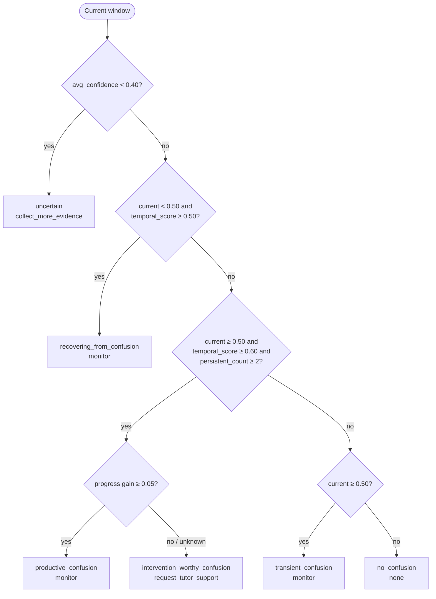

# 05 — Temporal Decision Engine

Code: `domain/temporal.py` (`confusion_temporal_decision`, `disengagement_temporal_decision`),
called from `domain/confusion.py` and `domain/disengagement.py`. History is stored by
`application/service.py`.

## 1. Why one window is not enough

A single window can be misleading:

- a learner may look away for a moment or answer one item slowly without being disengaged;
- a short period of confusion is a normal, often useful, part of learning;
- one modality may be noisy for a few seconds (lighting, head movement).

Interrupting the learner on every positive window would be annoying and would reduce trust in the
system. The temporal engine therefore asks for **evidence that persists across windows and is
trusted** before recommending support.

## 2. Rolling temporal history

For each session `(session_id, learner_id)` the service keeps the last 3 values
(`TEMPORAL_HISTORY_SIZE = 3`) of:

- confusion fused evidence and fusion confidence,
- disengagement fused evidence and fusion confidence,
- `task_progress` (for confusion only).

At decision time the current window is appended, and the last `window_size = 3` entries are used.
So each decision looks at **the current window plus up to two previous windows**. Early in a
session fewer windows are available and the summary uses what exists.

### 2.1 Temporal summary (shared by both detectors)

Over the recent windows (evidence `e_i`, confidence `c_i`):

```text
temporal_score   = Σ(e_i * c_i) / Σ c_i         (0.5 if Σ c_i == 0)
avg_confidence   = mean(c_i)
persistent_count = number of windows with e_i ≥ 0.50 AND c_i ≥ 0.50
```

- `temporal_score` is a **confidence-weighted average** of fused evidence: low-confidence windows
  count less.
- `persistent_count` counts only windows that were both positive and trusted.

### 2.2 Parameters (defaults used by the service)

| Parameter | Value | Role |
| --- | --- | --- |
| `window_size` | 3 | Windows in the temporal summary |
| `confusion_threshold` / `disengagement_threshold` | 0.50 | Evidence level that counts as positive |
| `intervention_threshold` | 0.60 | Minimum `temporal_score` for a persistent state |
| `min_persistent_windows` | 2 | Minimum `persistent_count` for a persistent state |
| `min_confidence` | 0.50 | Minimum confidence for a window to count as persistent |
| uncertainty cut-off | 0.40 (fixed in code) | `avg_confidence` below this → `uncertain` |
| `min_progress_gain` | 0.05 (provisional) | Minimum increase in `task_progress` across the recent windows for persistent confusion to count as productive |

## 3. Confusion states

Rules are checked **in this order**; the first match wins. `current` is the current window's fused
confusion evidence.

| # | Condition | State (API value) | `support_need` |
| --- | --- | --- | --- |
| 1 | `avg_confidence < 0.40` | `uncertain` | `collect_more_evidence` |
| 2 | `current < 0.50` and `temporal_score ≥ 0.50` | `recovering_from_confusion` | `monitor` |
| 3 | `current ≥ 0.50` and `temporal_score ≥ 0.60` and `persistent_count ≥ 2`, **and** progress gain ≥ 0.05 | `productive_confusion` | `monitor` |
| 4 | same as 3, but progress gain < 0.05 or unknown | `intervention_worthy_confusion` | `request_tutor_support` |
| 5 | `current ≥ 0.50` | `transient_confusion` | `monitor` |
| 6 | otherwise | `no_confusion` | `none` |

**Progress gain** asks whether the learner is still moving forward on the task. It is the
newest known `task_progress` value minus the oldest known value within the same recent windows
(`null` values are skipped). At least two known values are needed; otherwise progress is unknown
and persistent confusion is treated as intervention-worthy.

| Recent `task_progress` | Progress gain | Persistent confusion becomes |
| --- | --- | --- |
| 0.30 → 0.32 → 0.35 | 0.05 | `productive_confusion` |
| 0.60 → 0.60 → 0.60 | 0.00 (stuck) | `intervention_worthy_confusion` |
| 0.60 → 0.50 → 0.40 | −0.20 | `intervention_worthy_confusion` |
| `null` → `null` → 0.90 | unknown | `intervention_worthy_confusion` |

The gain is used rather than the progress level because a learner who is stuck at 60% of a task is
not making progress, while a learner moving quickly from 10% to 40% is. The 0.05 minimum
(`min_progress_gain` in `domain/temporal.py`) is a provisional design value that still has to be
calibrated on synchronized pilot data.

Meaning of each state:

- `no_confusion` — current evidence is below threshold and the recent trend is not confused.
- `transient_confusion` — current window is positive but not yet persistent or strong enough.
  Watch only.
- `productive_confusion` — confusion is persistent, but the learner is still making progress on
  the task. This follows the idea that some struggle is useful for learning, so the system does
  not interrupt.
- `intervention_worthy_confusion` — confusion is persistent, trusted, and the learner is not
  progressing. Ask the tutor component for support.
- `recovering_from_confusion` — the current window is no longer positive, but the recent trend
  still is. Watch until the trend settles.
- `uncertain` — the recent evidence is not trusted enough to decide. Collect more evidence
  instead of acting.



## 4. Disengagement states

The disengagement rules have the same structure, without the task-progress check.

| # | Condition | State (API value) | `support_need` |
| --- | --- | --- | --- |
| 1 | `avg_confidence < 0.40` | `uncertain` | `collect_more_evidence` |
| 2 | `current < 0.50` and `temporal_score ≥ 0.50` | `recovering_engagement` | `monitor` |
| 3 | `current ≥ 0.50` and `temporal_score ≥ 0.60` and `persistent_count ≥ 2` | `persistent_disengagement` | `request_reengagement_support` |
| 4 | `current ≥ 0.50` | `transient_disengagement` | `monitor` |
| 5 | otherwise | `engaged` | `none` |

## 5. Final recommended action

Each window produces two support needs. `_choose_recommended_action()` in
`application/service.py` merges them using a fixed priority:

| Priority | Rule | `recommended_action` |
| --- | --- | --- |
| 1 | disengagement needs `request_reengagement_support` | `request_reengagement_support` |
| 2 | confusion needs `request_tutor_support` | `request_tutor_support` |
| 3 | either needs `collect_more_evidence` | `collect_more_evidence` |
| 4 | either needs `monitor` | `monitor` |
| 5 | otherwise | `none` |

Re-engagement is placed above tutor support on purpose: if the learner is persistently not paying
attention, an academic explanation is unlikely to help until attention is restored (comment in the
code). Both individual support needs are still returned in the response, so the caller can see
when both detectors want support.

## 6. Illustrative runtime walkthrough

> This walkthrough only illustrates how the temporal rules behave at runtime with the currently
> committed model artifacts. It uses one synthetic input repeated four times. It is **not**
> research evaluation evidence and does **not** validate the detectors or the temporal design.

The same window from `backend/tests/test_learner_state.py` was sent four times with increasing
`window_id` (1–4). Visual features stay the same; the disengagement behaviour probability changes
because learner-history features change as the session history grows.

Disengagement detector (values rounded):

| Window | Fused evidence | Confidence | Recent windows positive & trusted | `temporal_score` | State | Action |
| --- | --- | --- | --- | --- | --- | --- |
| 1 | 0.486 | 0.527 | 0 | 0.486 | `engaged` | `none` |
| 2 | 0.618 | 0.700 | 1 | ≈ 0.561 | `transient_disengagement` | `monitor` |
| 3 | 0.617 | 0.701 | 2 | ≈ 0.582 | `transient_disengagement` | `monitor` |
| 4 | 0.623 | 0.712 | 3 | ≈ 0.619 | `persistent_disengagement` | `request_reengagement_support` |

At window 3 there are already two positive, trusted windows, but the confidence-weighted score is
still below 0.60 because window 1 is in the summary. At window 4, window 1 has dropped out of the
3-window history and support is requested. The confusion detector stays `no_confusion` in all four
windows for this input.

## 7. Design status

The window length, thresholds, persistence count and priority order are prototype design choices.
They are deterministic and easy to audit, but they have not been tuned on synchronized learner
data. The windows are counted by number, not by time, so the real-time meaning of "3 windows"
depends on how often the client sends windows.
