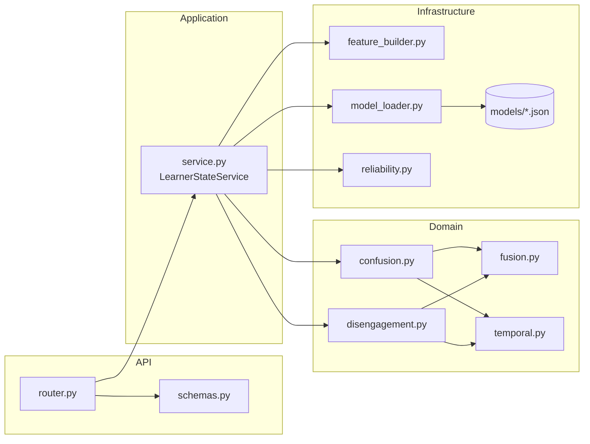

# 08 — Implementation and Testing

## 1. Implementation order

The learner-state backend was built bottom-up, so that each layer could be checked before the next
one depended on it. The order follows the repository history.

| Step | Commit | What was added | Main files |
| --- | --- | --- | --- |
| 1 | `feat: add learner state API schemas` | Initial request/response schemas | `api/schemas.py` |
| 2 | `feat: add reliability fusion and temporal logic` | Threshold-centred evidence, reliability-aware fusion, temporal decisions | `domain/fusion.py`, `domain/temporal.py` |
| 3 | `feat: add confusion detection engine` | Confusion pipeline for one window | `domain/confusion.py` |
| 4 | `feat: add disengagement detection engine (#5)` | Disengagement pipeline for one window | `domain/disengagement.py` |
| 5 | `feat: add learner state model inference (#8)` | Trained model files, feature builder, model loader with feature-order validation, reliability calculation; `xgboost` dependency | `infrastructure/models/*.json`, `infrastructure/feature_builder.py`, `infrastructure/model_loader.py`, `infrastructure/reliability.py`, `backend/pyproject.toml` |
| 6 | `feat: add unified learner state service` | Unified service with in-memory session history and action priority | `application/service.py` |
| 7 | `feat: expose learner state API` | Router, final schemas, registration in `main.py`, API test | `api/router.py`, `api/schemas.py`, `backend/app/main.py`, `backend/tests/test_learner_state.py` |

## 2. How the modules interact



- `router.py` depends only on the schemas and the service (plus `BehaviorObservation`).
- `service.py` is the only module that imports both domain and infrastructure code.
- Domain modules import only each other; they can be tested without models or FastAPI.

## 3. Automated tests

### 3.1 Learner-state tests

`backend/tests/test_learner_state.py` contains one end-to-end API test,
`test_evaluate_learner_state_and_reject_duplicate_window`. Through FastAPI's `TestClient` and the
real model files it checks that:

1. a valid window returns HTTP 200;
2. `session_id`, `learner_id` and `window_id` are echoed back;
3. `confusion` and `disengagement` both contain `visual_probability`, `behavior_probability`,
   `fused_evidence` and `confidence`;
4. `recommended_action` is one of the five allowed values;
5. sending the same `window_id` again returns HTTP 409 with
   `{"detail": "window_id must increase within a learner session"}`.

Because the test runs the real service, it also covers model loading and the feature-order checks
for all four models, feature construction, reliability, fusion and the temporal engine, at least
for this input.

The test uses a random `learner_id` (`uuid4()`), so it does not clash with history left in the
cached service by other tests.

### 3.2 Current coverage gaps

The following are **not** yet covered by dedicated tests and are good next additions:

- unit tests for `threshold_centered_evidence` (0, threshold, 1, invalid threshold);
- unit tests for `reliability_aware_fusion` (zero reliabilities, one modality unreliable,
  strong conflict);
- unit tests for each temporal state in both detectors, including `productive_confusion` vs
  `intervention_worthy_confusion`;
- tests for `calculate_visual_reliability` and `calculate_behavior_reliability` edge cases;
- tests for learner-history features before and after `MIN_BASELINE_HISTORY`;
- a multi-window API test that reaches a persistent state and checks the action priority;
- 422 validation tests for out-of-range fields.

### 3.3 Full repository suite

As of 2026-10-13, the repository test suite reports 72 passed.

Rerun `pytest` (see §4.3) to get the current result, because the count can change as the
repository evolves.

## 4. Developer commands

All commands are run from `backend/`.

### 4.1 Install dependencies

```bash
python -m venv .venv
# Linux / macOS
source .venv/bin/activate
# Windows (PowerShell)
.venv\Scripts\Activate.ps1

pip install -e ".[dev]"
cp .env.example .env      # then set DATABASE_URL
```

`DATABASE_URL` is required by the shared settings even though the learner-state component does not
use the database. The test suite sets it to `sqlite://` automatically (`tests/conftest.py`).

### 4.2 Lint with Ruff

```bash
ruff check .
```

### 4.3 Run tests

```bash
pytest                                  # whole backend suite
pytest -q                               # short output with pass count
pytest tests/test_learner_state.py -v   # learner-state test only
```

### 4.4 Start the API

```bash
uvicorn app.main:app --reload
```

- API base: `http://localhost:8000/api/v1`
- Swagger UI: `http://localhost:8000/docs`

Use a single worker. Session history is in memory and is not shared across workers (see
[`07`](07_EVALUATION_AND_LIMITATIONS.md#43-runtime-and-deployment)). With `--reload`, every code
change restarts the process and clears all session history.

## 5. Developer workflow for testing the learner-state API

1. Start the server with `uvicorn app.main:app --reload`.
2. Open `http://localhost:8000/docs` and expand **learner-state → POST /api/v1/learner-state**.
3. Paste the example request from [`06_API_SPEC.md`](06_API_SPEC.md#41-request) and execute it.
   Expect HTTP 200; the first request may be slower because the four models are loaded then.
4. Execute the same body again without changes. Expect HTTP 409 (duplicate `window_id`).
5. Increase `window_id` to 2, 3, 4 and execute each. Watch `disengagement.state` move from
   `engaged` to `transient_disengagement` to `persistent_disengagement` and
   `recommended_action` change to `request_reengagement_support`. This sequence is what the
   current committed model artifacts produce for this input; it is a functional check, not an
   evaluation result.
6. Start a fresh session by changing `session_id` (or `learner_id`) and try:
   - `face_visibility_ratio: 0.0` → both `visual_reliability` values become 0 and fusion follows
     behaviour only;
   - large `mean_abs_yaw` (e.g. 25) → lower visual reliability;
   - `task_progress: 0.8` vs `0.2` when confusion is persistent → `productive_confusion` vs
     `intervention_worthy_confusion`.
7. Try invalid input (e.g. `face_visibility_ratio: 1.4`) and confirm HTTP 422.

The same requests can be sent from the command line:

```bash
curl -X POST http://localhost:8000/api/v1/learner-state \
  -H "Content-Type: application/json" \
  -d @window.json
```

Before committing, run `ruff check .` and `pytest`. The repository hooks run Ruff on commit and
the backend test suite on push (see [`docs/contributing.md`](../contributing.md)).
