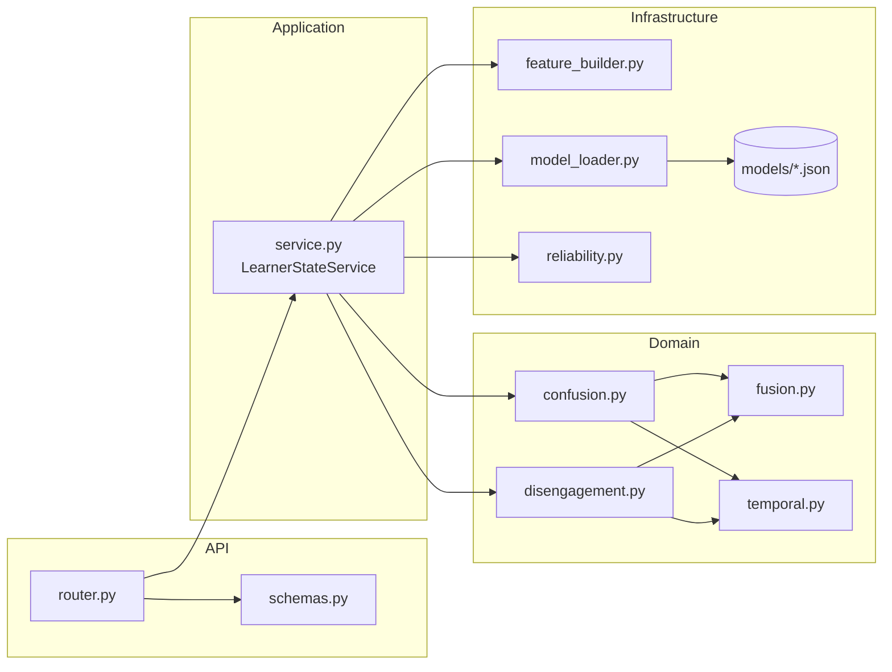

# 08 — Implementation and Testing

## 1. Implementation order

The learner-state backend was built bottom-up, so that each layer could be checked before the next
one depended on it. The order follows the repository history.

| Step | Commit | What was added | Main files |
| --- | --- | --- | --- |
| 1 | `feat: add learner state API schemas` | Initial request/response schemas | `api/schemas.py` |
| 2 | `feat: add reliability fusion and temporal logic` | Threshold-centred evidence, reliability-aware fusion, temporal decisions | `domain/fusion.py`, `domain/temporal.py` |
| 3 | `feat: add confusion detection engine` | Confusion pipeline for one window | `domain/confusion.py` |
| 4 | `feat: add disengagement detection engine (#5)` | Disengagement pipeline for one window | `domain/disengagement.py` |
| 5 | `feat: add learner state model inference (#8)` | Trained model files, feature builder, model loader with feature-order validation, reliability calculation; `xgboost` dependency | `infrastructure/models/*.json`, `infrastructure/feature_builder.py`, `infrastructure/model_loader.py`, `infrastructure/reliability.py`, `backend/pyproject.toml` |
| 6 | `feat: add unified learner state service` | Unified service with in-memory session history and action priority | `application/service.py` |
| 7 | `feat: expose learner state API` | Router, final schemas, registration in `main.py`, API test | `api/router.py`, `api/schemas.py`, `backend/app/main.py`, `backend/tests/test_learner_state.py` |
| 8 | `feat: refine productive confusion and expose temporal decision values` | Progress-gain rule for productive confusion; `temporal_score`, `average_confidence` and `persistent_count` in the response; unit and service tests | `domain/temporal.py`, `domain/confusion.py`, `domain/disengagement.py`, `application/service.py`, `api/`, `backend/tests/learner_state/` |
| 9 | `feat: store skill-specific learner state for the AI Tutor` | `skill_id` in the request; learner existence check; `learner_skill_states` table and migration; support-need contract and provider | `application/support_need.py`, `infrastructure/db/`, `api/`, `backend/alembic/versions/20261014_01_create_learner_state_tables.py` |
| 10 | `fix: align learner-state inference with training and add verified model results (#15)` | Confusion uses behavioural data quality only (the history factor applies to disengagement only); missing `bottom_hint` filled with the training median (0.0); Kaggle training notebooks and verified unimodal results | `application/service.py`, `infrastructure/reliability.py`, `infrastructure/feature_builder.py`, `research/learner-state/`, docs 02, 03, 07 |
| 11 | `Feature/game dev (#20)` (by a teammate) | Model loader rewritten to evaluate the XGBoost JSON trees directly, removing the `xgboost` dependency | `infrastructure/model_loader.py`, `tests/learner_state/test_model_loader.py` |
| 12 | `fix: match XGBoost float32 comparisons in the learner-state model loader` | Inputs and split thresholds rounded to float32 as in XGBoost; reference predictions from real XGBoost | `infrastructure/model_loader.py`, `tests/learner_state/test_model_reference_predictions.py`, `research/learner-state/tools/generate_model_reference_predictions.py` |
| 13 | `feat: prepare learner-state for in-process game integration` | `LearnerStateRecorder` use case and shared service instance; `WindowOrderError`, `UnknownLearnerError`; `session_id`, `STALE` and freshness rules on the support-need contract; Option B integration design | `application/recording.py`, `application/service.py`, `application/support_need.py`, `api/router.py`, docs 01, 07, 09, 11 |
| 14 | `feat: retrain behaviour models without ASSISTments-only fields` | Behaviour models retrained without `position` and `first_action` (ablation on Kaggle); confusion behaviour threshold 0.78; both fields removed from the API, which now rejects unknown behaviour fields | `infrastructure/models/`, `infrastructure/model_loader.py`, `infrastructure/feature_builder.py`, `domain/confusion.py`, `api/`, `research/learner-state/notebooks/kaggle_behaviour_ablation_cells.py`, docs 01–07, 11 |
| 15 | `feat: add learner-state adapter for scored game answers` | `GameAnswerRecorder`, the adapter behind the game's `LearnerStateAnswerGateway`; doc 11 updated for the game side built in #26 | `infrastructure/game_answers.py`, `tests/learner_state/test_game_answers.py`, docs 08, 11 |

## 2. How the modules interact



- `router.py` depends only on the schemas and the service (plus `BehaviorObservation`).
- `service.py` is the only module that imports both domain and infrastructure code.
- Domain modules import only each other; they can be tested without models or FastAPI.

## 3. Automated tests

### 3.1 Learner-state tests

Learner-state tests live in two places:

| File | Type | What it checks |
| --- | --- | --- |
| `tests/learner_state/test_fusion.py` | Unit | Threshold-centred evidence (0, threshold, 1, clipping, invalid thresholds); reliability weights; one unreliable modality; both reliabilities 0; agreement; conflict penalty; the documented worked example |
| `tests/learner_state/test_reliability.py` | Unit | Visual reliability for normal pose, extreme pose, linear decrease between quantiles and hidden face; behavioural data-quality penalties and history factor |
| `tests/learner_state/test_feature_builder.py` | Unit | Feature order matches each model; missing `bottom_hint` filled with the training median and flagged; no baseline below 5 windows; deviation values; only the last 20 windows used; negative response time |
| `tests/learner_state/test_temporal.py` | Unit | Every confusion and disengagement state; low-confidence windows not counted as persistent; progress-gain rule (rising, stuck, falling, unknown, configurable); confidence-weighted summary; history validation |
| `tests/learner_state/test_learner_state_service.py` | Service | Action priority (every combination order); confusion reliability independent of session length; persistent disengagement; re-engagement before tutor support; productive vs intervention-worthy confusion; duplicate/older windows; rejected windows not changing history; session isolation; `clear_session` |
| `tests/learner_state/test_model_loader.py` | Unit | Four fixed predictions; every named feature required |
| `tests/learner_state/test_model_reference_predictions.py` | Unit | Evaluator equals real XGBoost on 1,200 reference cases (split-threshold and realistic inputs); float32 rounding; extreme inputs |
| `tests/learner_state/test_game_answers.py` | Unit + repository | Game adapter: same signature as the game's `LearnerStateAnswerGateway`; game answer → behavioural fields; missing camera → zero visual reliability and confidence equal to behavioural reliability; unknown response time records nothing; stored state and returned action with the real models; errors logged and raised |
| `tests/learner_state/test_recording.py` | Unit + API | Recording use case: stores the latest skill state, rejects an unknown learner or invalid Universal Skill ID without changing history, `WindowOrderError`; HTTP and in-process windows share one session history |
| `tests/learner_state/test_support_need.py` | Unit + repository | Support need = confusion `temporal_score`, none when `uncertain`; provider statuses `AVAILABLE` / `UNCERTAIN` / `NOT_FOUND`; request and result validation; repository keeps the latest row per learner and skill; freshness: same session, maximum age, `STALE` before `UNCERTAIN`, naive database times |
| `tests/learner_state/test_migration.py` | Migration | Migration `20261014_01` creates exactly the `learner_skill_states` table the model describes, and its downgrade removes it |
| `tests/test_learner_state.py` | API | 200 response with all fields including `skill_id` and the temporal values; 409 on a duplicate window; gaps in `window_id` allowed; 422 for an out-of-range field or missing `skill_id`; 404 for an unknown learner; 422 for the removed ASSISTments-only fields; latest state stored and readable per skill |

The service tests use a small fake model object that returns fixed probabilities. This checks the
decision logic independently of what the trained models output. The API tests use the real model
files, so they also cover model loading and the feature-order checks.

The API tests create a new learner through `POST /api/v1/learners` for each test, so they do not
clash with history left in the cached service by other tests.

The Knowledge Tracing migration test (`tests/knowledge_tracing/test_schema.py`) was adjusted to
compare only the tables its own migration creates, because it previously failed whenever another
module added a table.

### 3.2 Current coverage gaps

- No test checks model outputs against expected values, because no reference outputs from the
  training environment are stored in the repository.
- Concurrent requests to the same session (the service lock) are not tested.

### 3.3 Full repository suite

As of 2026-10-18, the learner-state tests (`tests/learner_state` and `tests/test_learner_state.py`)
report 143 passed. The full repository suite also passed locally on Windows on the same date.

Rerun `pytest` (see §4.3) to get the current result, because the count can change as the
repository evolves.

## 4. Developer commands

All commands are run from `backend/`.

### 4.1 Install dependencies

```bash
python -m venv .venv
# Linux / macOS
source .venv/bin/activate
# Windows (PowerShell)
.venv\Scripts\Activate.ps1

pip install -e ".[dev]"
cp .env.example .env      # then set DATABASE_URL
alembic upgrade head      # creates learners, knowledge tracing and learner-state tables
```

`DATABASE_URL` must point to the PostgreSQL database: the endpoint checks that the learner exists
and stores the latest state per skill. The test suite uses SQLite instead (`tests/conftest.py`).

### 4.2 Lint with Ruff

```bash
ruff check .
```

### 4.3 Run tests

```bash
pytest                                  # whole backend suite
pytest -q                               # short output with pass count
pytest tests/test_learner_state.py -v   # learner-state test only
```

### 4.4 Start the API

```bash
uvicorn app.main:app --reload
```

- API base: `http://localhost:8000/api/v1`
- Swagger UI: `http://localhost:8000/docs`

Use a single worker. Session history is in memory and is not shared across workers (see
[`07`](07_EVALUATION_AND_LIMITATIONS.md#43-runtime-and-deployment)). With `--reload`, every code
change restarts the process and clears all session history.

## 5. Developer workflow for testing the learner-state API

1. Start the server with `uvicorn app.main:app --reload`.
2. Open `http://localhost:8000/docs` and expand **learner-state → POST /api/v1/learner-state**.
3. Create a learner with **learners → POST /api/v1/learners** (for example
   `{"grade": 5, "preferred_language": "si"}`) and copy the returned `id`.
4. Paste the example request from [`06_API_SPEC.md`](06_API_SPEC.md#41-request), replace
   `learner_id` with that `id`, and execute it.
   Expect HTTP 200; the first request may be slower because the four models are loaded then.
5. Execute the same body again without changes. Expect HTTP 409 (duplicate `window_id`).
6. Increase `window_id` to 2, 3, 4 and execute each. Watch `disengagement.state` move from
   `engaged` to `transient_disengagement` to `persistent_disengagement` and
   `recommended_action` change to `request_reengagement_support`. This sequence is what the
   current committed model artifacts produce for this input; it is a functional check, not an
   evaluation result.
7. Start a fresh session by changing `session_id` and try:
   - `face_visibility_ratio: 0.0` → both `visual_reliability` values become 0 and fusion follows
     behaviour only;
   - large `mean_abs_yaw` (e.g. 25) → lower visual reliability;
   - when confusion is persistent, rising `task_progress` across windows (e.g. 0.20, 0.30, 0.40)
     vs unchanged `task_progress` (e.g. 0.60, 0.60, 0.60) → `productive_confusion` vs
     `intervention_worthy_confusion`.
8. Try invalid input (e.g. `face_visibility_ratio: 1.4` or no `skill_id`) and confirm HTTP 422,
   and a random `learner_id` to confirm HTTP 404.

The same requests can be sent from the command line:

```bash
curl -X POST http://localhost:8000/api/v1/learner-state \
  -H "Content-Type: application/json" \
  -d @window.json
```

Before committing, run `ruff check .` and `pytest`. The repository hooks run Ruff on commit and
the backend test suite on push (see [`docs/contributing.md`](../contributing.md)).
