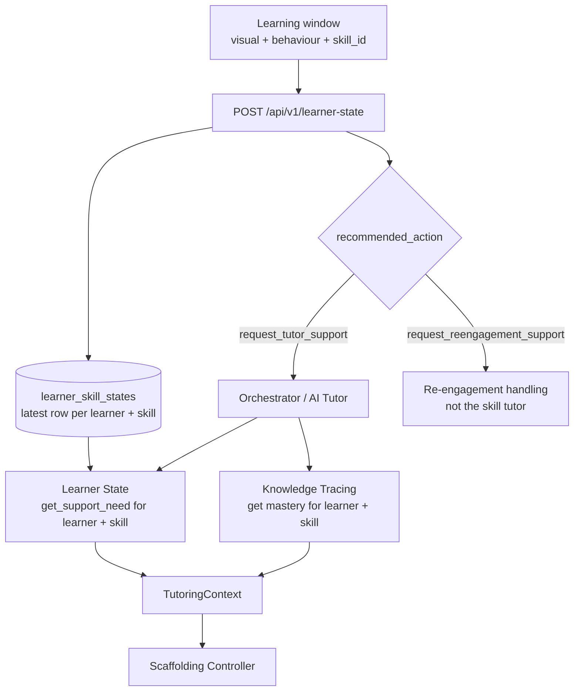

# 09 — Support-Need Handoff to the AI Tutor

## 1. Purpose

The AI Tutor (`adaptive_tutor`) chooses an assistance level from a `TutoringContext`. One of its
inputs is `support_need`: a number from 0 to 1 for **one learner and one skill**. Learner State
owns this value. This document defines how Learner State stores it and how the tutor reads it.

Responsibilities stay separate:

| Component | Responsibility |
| --- | --- |
| Learner State | Detects confusion and disengagement, recommends the **type** of support, stores the latest state per skill, publishes `support_need` |
| Knowledge Tracing | Publishes skill-specific `mastery` |
| AI Tutor | Confirms the skill, reads `mastery` and `support_need`, chooses and delivers the actual help |

Learner State never calls the tutor and never generates tutoring content.

## 2. Flow



1. The client sends each window with the `skill_id` of the question being answered.
2. Learner State evaluates the window and overwrites the row for (`learner_id`, `skill_id`).
3. When the response says `request_tutor_support`, the caller routes the learner to the AI Tutor
   for that skill.
4. The tutor reads `mastery` from Knowledge Tracing and `support_need` from Learner State for the
   same (`learner_id`, `skill_id`), then builds its `TutoringContext`.

Who performs step 3 (the client or a backend orchestrator) is not decided yet; see §7.

## 3. The contract

Defined in `backend/app/learner_state/application/support_need.py`. It follows the same pattern as
the mastery retrieval contract on the AI Tutor teammate's skill-mapper branch.

### 3.1 Request — `SupportNeedRequest`

| Field | Type | Rule |
| --- | --- | --- |
| `learner_id` | UUID | Shared learner identity |
| `skill_id` | string | 1–16 characters after trimming spaces |

Extra fields and wrong types are rejected. Whether `skill_id` belongs to the skill taxonomy is
checked by the caller, as in the mastery contract.

### 3.2 Result — `SupportNeedResult`

| Field | Meaning |
| --- | --- |
| `learner_id`, `skill_id` | Repeated from the request so the caller can check the identity |
| `status` | See below |
| `support_need` | 0–1, present only when `status` is `AVAILABLE` |
| `observed_at` | `timestamp` of the window that produced the stored state; absent for `NOT_FOUND` |

| Status | Meaning | `support_need` |
| --- | --- | --- |
| `AVAILABLE` | A trusted value exists for this learner and skill | Required |
| `UNCERTAIN` | A state exists, but the latest confusion state was `uncertain` (low confidence) | Absent |
| `NOT_FOUND` | No window has been evaluated for this learner and skill | Absent |

A missing value is never replaced by `0`, `0.5` or another made-up number.

### 3.3 Provider

```python
class SupportNeedProvider(Protocol):
    def get_support_need(self, request: SupportNeedRequest) -> SupportNeedResult: ...
```

`StoredSupportNeedProvider` implements it on top of the `LearnerSkillStateRepository` protocol.
The consumer depends only on the application contract. The concrete objects are built where the
application is wired together (for example in a FastAPI dependency):

```python
provider = StoredSupportNeedProvider(SqlAlchemyLearnerSkillStateRepository(session))
result = provider.get_support_need(SupportNeedRequest(learner_id=learner_id, skill_id="MAT-FRC"))

if result.status is SupportNeedStatus.AVAILABLE:
    support_need = result.support_need
```

## 4. How the value is calculated

```text
support_need = confusion temporal_score     if the confusion state is not "uncertain"
             = not available                if the confusion state is "uncertain"
```

`temporal_score` is the confidence-weighted average of fused confusion evidence over the recent
windows (see [`05`](05_TEMPORAL_DECISION_ENGINE.md)). It was chosen because it already combines
persistence and confidence, so one noisy window has limited effect.

**Only confusion is used.** Disengagement means the learner's attention needs to return. It is not
a skill gap, and giving stronger academic hints would be the wrong response. It stays as
`request_reengagement_support`.

### 4.1 Meaning of the scale

| `support_need` | Meaning on the Learner State scale |
| --- | --- |
| < 0.50 | Recent confusion evidence below the models' decision thresholds |
| 0.50–0.60 | Around the thresholds (transient confusion is possible) |
| ≥ 0.60 | At or above the intervention threshold; with at least 2 persistent windows this gives `intervention_worthy_confusion` or `productive_confusion` |

The tutor's Controller V1 treats `support_need ≥ 0.70` as high. On the Learner State scale the
intervention level is 0.60, so the two thresholds do not mean the same thing. The mapping is a
**provisional design decision** and must be agreed between both components and calibrated on
synchronized pilot data.

## 5. What is stored

One row per (`learner_id`, `skill_id`) in `learner_skill_states`, overwritten by each new window
for that skill. The columns are listed in [`01_ARCHITECTURE.md`](01_ARCHITECTURE.md#6-stored-skill-state-database).
Only derived states and scores are stored; no visual features, behaviour features or images.

## 6. Limitations

- **Provisional mapping.** Neither the choice of `temporal_score` nor its scale is validated.
- **Confusion evidence depends mostly on the visual model.** With the current model artifacts, the
  confusion behaviour model rarely reaches its 0.79 threshold, so the value inherits that
  limitation.
- **Skill switches inside a session.** The temporal history is kept per session, not per skill. If
  a learner moves to a new skill, the first windows of the new skill still include up to two
  windows from the previous skill.
- **Staleness.** The stored value is the latest one, however old. `observed_at` is returned so the
  caller can decide whether it is still recent enough; no expiry policy exists yet.
- **No taxonomy check.** `skill_id` is stored as sent by the client.

## 7. Open questions for the AI Tutor teammate

1. Which component routes the learner to the tutor when the response says
   `request_tutor_support`: the client app or a backend orchestrator?
2. Should `UNCERTAIN` and `NOT_FOUND` defer the tutor call, or use a separately designed fallback?
   (Controller V1 currently requires a value.)
3. How recent must `observed_at` be for the tutor to use the value?
4. Should the 0.70 "high" cut-off in Controller V1 be aligned with the 0.60 intervention level used
   here?
