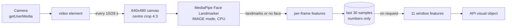

# 10 — Frontend Integration (on-device visual features)

This document describes the browser side of the learner-state component in
`frontend/src/features/learner-state/`. It turns the learner's camera image into the 11 derived
visual features expected by `POST /api/v1/learner-state` (see [`06_API_SPEC.md`](06_API_SPEC.md)).

Status:

| Part | Status |
| --- | --- |
| Visual feature calculations (eye openness, gaze, head pose, aggregation) | Implemented; matches the Python/OpenCV training code on given landmarks (§4) |
| Camera, MediaPipe, 10-second windows, no-face handling | Implemented |
| Browser MediaPipe vs Python MediaPipe on the same frames | Passed a local engineering equivalence test on 9 developer-owned clips (§9) |
| Snapshot for the game's answer request (`useGameVisualFeatures`, §12) | Implemented; not yet used by the game screen, which first needs a camera-consent flow |
| Behaviour values, recording windows, handling `recommended_action` | Done by the game backend (Option B, [`11`](11_GAME_INTEGRATION.md)), not by this module |

§9 shows that, given the same frames, the browser pipeline produces the same 11 features as the
training pipeline within small tolerances. It does not cover live video decoding or camera
scaling, and it is not a validation of confusion or disengagement detection.

## 1. Responsibilities

The learner-state frontend code is a self-contained module. Learning and game screens may be
owned by other team members; they use this module without handing their screens over to it.

| Owned by the learner-state module | Owned by the screen that uses it |
| --- | --- |
| Camera permission, capture and shutdown | Deciding when the camera is on |
| MediaPipe processing on the device | Layout, preview placement, wording |
| Visual feature extraction and 10-second windows | Sending the snapshot with the answer; the game backend adds the behaviour values |

## 2. Module structure

```text
frontend/src/features/learner-state/
├── useVisualFeatures.ts          # React hook: start/stop, states, getVisualFeatures()
├── game/useGameVisualFeatures.ts # consent-driven camera + `visualFeatures` callback for GameHost
├── camera/camera.ts              # getUserMedia, error classification, stopping tracks
├── visual/
│   ├── faceLandmarker.ts         # MediaPipe Face Landmarker (pinned, bundled, notebook options)
│   ├── frameCapture.ts           # live video -> 640x480 frame (centre crop to 4:3)
│   ├── frameFeatures.ts          # per-frame eye openness, gaze, normalised pitch/roll
│   ├── headPose.ts               # port of solvePnP(ITERATIVE) + Rodrigues + RQDecomp3x3
│   ├── windowFeatures.ts         # 30 samples -> 11 features
│   ├── sampler.ts                # ~3 samples per second, last 10 seconds
│   ├── apiVisualFeatures.ts      # window -> API `visual` object, no-face handling
│   └── assets/face_landmarker.task
└── dev/LearnerStateDevPage.tsx   # developer-only test page
frontend/build-plugins/mediapipeTelemetry.ts   # disables MediaPipe's Google usage logging
```

## 3. Processing pipeline



- **Window:** one learner-state window corresponds to one answered question. The visual part is
  the last 10 seconds before the answer.
- **Sampling:** 30 samples spread over 10 seconds, one every 10/29 s (≈ 2.9 per second). This
  mirrors `np.linspace(0, last_frame, 30)` over the 10-second DAiSEE clips used in training.
- **Frame size:** each sample is centre-cropped to 4:3 and drawn at 640×480, the DAiSEE frame size.
  Eye openness depends on the aspect ratio, so frames are cropped, never stretched. The raw
  (un-mirrored) camera image is used; a preview may be mirrored for display only.
- **Detector options** (same as the notebook): IMAGE running mode, 1 face, minimum face detection
  and presence confidence 0.5, CPU delegate.
- **Per-frame and window features:** exactly the notebook formulas, including the pitch
  normalisation and the roll wrap `((roll + 90) mod 180) − 90` with Python modulo semantics, and
  NumPy's population standard deviation.

## 4. Verification of the feature calculations

`research/learner-state/tools/generate_visual_feature_fixtures.py` runs the notebook's own
functions (copied unchanged) with OpenCV 4.14.0 — the version used in the notebook — on 50
synthetic landmark sets and 5 aggregation windows. `visual/visualFeatures.test.ts` compares the
TypeScript results:

| Check | Result |
| --- | --- |
| Eye openness, gaze ratio | equal to 12 decimal places |
| Raw head pose vs OpenCV (150 angles) | largest difference 0.0000245° |
| Pitch normalisation, roll wrap | equal |
| 30-frame aggregation | equal to 12 decimal places |

**Scope:** these tests start from landmarks. They show that the TypeScript calculations match the
Python/OpenCV training implementation. They do not show that browser MediaPipe produces the same
landmarks as the Python MediaPipe used in training; see §9.

## 5. MediaPipe assets

| Asset | Version | How it is shipped |
| --- | --- | --- |
| `@mediapipe/tasks-vision` | **1.0.1** exactly (same as the notebook's Python MediaPipe 1.0.1) | npm dependency without `^` |
| WebAssembly engine (SIMD and non-SIMD) | from the same package | imported with Vite `?url`; emitted as app files |
| `face_landmarker.task` (float16) | Google model version **1**, 3,758,596 bytes, SHA-256 `64184e229b263107bc2b804c6625db1341ff2bb731874b0bcc2fe6544e0bc9ff` | stored in the repository, emitted as an app file |

The notebook downloaded the model from the `float16/latest` URL. When the model was pinned
(2026-10-14), `latest` and version `1` were byte-identical and no version 2 existed.

All files are served from the app's own origin (the web server, or inside the Capacitor app), so
MediaPipe works offline and does not download anything from Google's CDN. Tests check that the
dependency version is exact and that the bundled model's size and SHA-256 match.

### Disabled usage logging

`@mediapipe/tasks-vision` 1.0.1 always starts a usage logger that sends the task type, running
mode, platform, library version and timing statistics to `odml.pa.googleapis.com` about once a
minute. It sends no images, landmarks or features, but learning sessions should not contact
outside servers. The Vite plugin `build-plugins/mediapipeTelemetry.ts` replaces that single URL
in MediaPipe's code with an address that `fetch()` rejects before any network access; MediaPipe
then stops its logger. The build fails if the URL is not found exactly once, so a version change
cannot silently re-enable it. This was checked in the development server and in a build.

## 6. Privacy: raw frames stay on the device

| Measure | Where |
| --- | --- |
| Frames are drawn into an in-memory canvas that is never added to the page | `frameCapture.ts` |
| The canvas is only passed to MediaPipe, which runs on the device | `faceLandmarker.ts` |
| Only numeric per-frame features are kept (at most 30) | `sampler.ts` |
| Only the 11 aggregated numbers are exposed to callers | `useVisualFeatures.ts` → `getVisualFeatures()` |
| No camera audio is requested | `camera.ts` |
| MediaPipe usage logging disabled | `build-plugins/mediapipeTelemetry.ts` |
| A test fails if the camera/visual code uses any API that could encode, record, store or send image data (`toDataURL`, `toBlob`, `getImageData`, `MediaRecorder`, `captureStream`, `fetch`, `XMLHttpRequest`, `sendBeacon`, `WebSocket`, `localStorage`, `indexedDB`, …) | `privacyGuard.test.ts` |

No face recognition or identification is performed.

## 7. Camera states, errors and shutdown

`useVisualFeatures()` exposes `status.state`:

| State | Meaning |
| --- | --- |
| `idle` | Not started |
| `requesting-permission` | Waiting for the camera permission prompt |
| `loading-model` | Camera on; MediaPipe is loading |
| `running` | Sampling on the device |
| `stopped` | Stopped by the screen, or the camera track ended |
| `error` | See kinds below |

Error kinds: `insecure-context` (not HTTPS/localhost), `unsupported`, `permission-denied`,
`no-camera`, `camera-busy`, `model-load-failed`, `unknown`.

`stop()` and leaving the screen (unmounting the hook) stop all camera tracks, so the camera
indicator turns off, and release MediaPipe. A start that is still in progress is cancelled. If
the operating system ends the camera track, the pipeline stops cleanly.

## 8. No-face and missing-face handling

The API requires 11 finite numbers. `toApiVisualFeatures()` returns `usable: false` and sends
placeholder zeros with `face_visibility_ratio = 0` when:

| Situation | Reason |
| --- | --- |
| Nothing was sampled in the last 10 seconds | `no-samples` |
| No face in any sample | `no-face` |
| Faces seen, but head pose never solved | `no-head-pose` |
| Any non-finite value | `invalid-value` |

With `face_visibility_ratio = 0` the backend's visual reliability is 0, so the visual model gets
zero weight in fusion ([`04`](04_RELIABILITY_AND_FUSION.md)). When the face is missing only in
some samples, the real features are sent and `face_visibility_ratio` reflects the share of
samples with a face, exactly as in training.

## 9. Local equivalence test (browser vs Python MediaPipe)

Purpose: check that browser MediaPipe 1.0.1 plus the TypeScript features produce **sufficiently
equivalent final 11 features** to the notebook's Python MediaPipe 1.0.1 pipeline on the same
input frames. Landmark differences are reported as supporting information; final feature parity
is the main criterion.

This is a **local engineering equivalence test using developer-owned test frames**. It is **not**
learner-study data or research-participant data, and it is **not** a scientific validation of
confusion or disengagement detection. It only checks implementation consistency between the
Python training feature pipeline and the browser runtime feature pipeline.

Plan:

1. The developer stores a small set of frames showing only their own face in a local folder named
   `local-test-frames/` (for example `research/learner-state/local-test-frames/`). The pattern
   `**/local-test-frames/` is in `.gitignore`. The frames are never committed, uploaded or
   included in test artifacts.
2. A Python script runs the notebook pipeline (MediaPipe 1.0.1, the same `.task` model, IMAGE mode,
   the same options) on the frames, grouped into windows of 30.
3. A browser runner runs the bundled MediaPipe and the TypeScript features on the same frames.
4. Only numeric results are committed: per-landmark coordinate differences, per-feature
   differences for the 11 window features, maximum and mean errors, and the configuration and
   versions used. No frames, screenshots or face crops are stored in the repository.
5. Acceptance tolerances for the 11 features are stated before the run (below) and reported with
   the results.

Acceptance tolerances (absolute difference of each clip's window feature, Python vs browser),
fixed on 2026-10-18 before the first comparison:

| Features | Tolerance | Reason |
| --- | --- | --- |
| `mean_eye_openness`, `std_eye_openness`, `mean_gaze_ratio`, `std_gaze_ratio` | 0.01 | ratios of landmark distances |
| `mean_pitch`, `mean_yaw`, `mean_roll`, `mean_abs_pitch`, `mean_abs_yaw`, `mean_abs_roll` | 1.0° | small against the reliability quantiles (Q75 of 6–11°, [`04`](04_RELIABILITY_AND_FUSION.md#12-head-pose-quality)) |
| `face_visibility_ratio` | 1/30 | at most one of the 30 frames differs in face detection |

A feature that is missing in a window (no face, or no head pose) must be missing on both sides.

How to run (from the repository root; tool:
`research/learner-state/tools/mediapipe_equivalence.py`):

1. Create a separate environment with the notebook's versions:
   `py -3.12 -m venv research/learner-state/.venv`, then
   `research/learner-state/.venv/Scripts/python -m pip install mediapipe==1.0.1 "opencv-contrib-python==4.14.0.*"`.
   Only one OpenCV package may be installed: MediaPipe pulls in `opencv-contrib-python`, and a
   second `opencv-python` would make the `cv2` version ambiguous.
2. Put the clips in `research/learner-state/local-test-frames/clips/`.
3. `… python research/learner-state/tools/mediapipe_equivalence.py extract`: 30 frames per clip with
   the notebook's `np.linspace` selection, centre-cropped to 4:3, resized to 640×480 and saved as
   lossless PNG in `local-test-frames/frames/`, so both pipelines read the same pixels.
4. `… mediapipe_equivalence.py python`: the notebook's MediaPipe pipeline and feature functions
   (the copies in `generate_visual_feature_fixtures.py`).
5. Browser: `npm run dev`, open `http://localhost:5173/?dev=learner-state`, section
   **Equivalence test**, pick `local-test-frames/frames`, **Run**, then **Save results** as
   `local-test-frames/browser-results.json` (Edge or Chrome). The page uses the app's bundled
   MediaPipe, detector and feature code.
6. `… mediapipe_equivalence.py compare` writes
   `research/learner-state/results/mediapipe_equivalence_results.json`: per-feature differences,
   pass/fail against the tolerances, face-detection agreement and landmark distances (pixels).
   No frames, landmarks or feature values are written there.

Scope: identical decoded frames are given to both pipelines. Differences in live video decoding
and in the browser's 640×480 scaling of camera frames are not covered by this test.

### 9.1 Result (2026-10-18)

Run on 9 developer-owned clips (270 frames): 6 clips with the face in every frame, 2 with the face
in some frames, 1 without a face. Python: MediaPipe 1.0.1, OpenCV 4.14.0, NumPy 2.5.4,
Python 3.12.0. Browser: `@mediapipe/tasks-vision` 1.0.1 in Google Chrome on Windows. Full
numbers: `research/learner-state/results/mediapipe_equivalence_results.json`.

**Passed.** Largest difference per window feature over the 9 clips:

| Feature | Largest difference | Tolerance |
| --- | --- | --- |
| `mean_eye_openness` | 0.000021 | 0.01 |
| `std_eye_openness` | 0.000031 | 0.01 |
| `mean_gaze_ratio` | 0.000017 | 0.01 |
| `std_gaze_ratio` | 0.000009 | 0.01 |
| `mean_pitch` | 0.0005° | 1.0° |
| `mean_yaw` | 0.0005° | 1.0° |
| `mean_roll` | 0.0002° | 1.0° |
| `mean_abs_pitch` | 0.0019° | 1.0° |
| `mean_abs_yaw` | 0.0008° | 1.0° |
| `mean_abs_roll` | 0.0001° | 1.0° |
| `face_visibility_ratio` | 0 | 1/30 |

Supporting results:

- Face detection agreed on all 270 frames (195 with a face on both sides, 75 without on both).
  Missing window values (the clip without a face) were missing on both sides.
- Landmarks of the 195 frames: mean distance 0.0012 px, largest 0.026 px at 640×480.
- Per-frame differences: eye openness and gaze ratio at most 0.00012; pitch, yaw and roll at most
  0.0084°.

The remaining differences are most likely floating-point differences between the browser
(WebAssembly) and native Python MediaPipe builds; they are far below the tolerances. This is an
implementation consistency check on one developer's face, lighting and camera, not a participant
study.

## 10. Native camera permissions (Capacitor)

The native projects are not in the repository (`frontend/android/`, `frontend/ios/` are generated
and ignored). When they are created:

- **iOS** (`ios/App/App/Info.plist`): `NSCameraUsageDescription`. iOS allows one text per app,
  shared with the paper-photo feature
  ([`docs/bhs-kt/07_FRONTEND_AND_IPHONE.md`](../bhs-kt/07_FRONTEND_AND_IPHONE.md)), so the wording
  must cover both uses and be agreed with that teammate, for example: *"MindBridge uses the camera
  to photograph answered paper pages and, during learning, to estimate attention from face
  position. Video is processed on this device and is never stored or sent."* Live camera access
  in the WebView needs iOS 14.3 or later.
- **Android** (`android/app/src/main/AndroidManifest.xml`):
  `<uses-permission android:name="android.permission.CAMERA" />`. Capacitor's WebView forwards
  the page's camera request to the Android permission prompt.
- **Web:** the camera requires HTTPS or `localhost`. For testing on a phone browser use an HTTPS
  tunnel as described in the KT frontend document.

## 11. Developer test page and commands

In development builds only, open the app with `?dev=learner-state` (for example
`http://localhost:5173/?dev=learner-state`). The page starts and stops the camera, shows the
states, a mirrored preview and the current 11 features. It is not included in production builds.

From `frontend/`:

```bash
npm ci            # install exactly the locked versions
npm test          # Vitest unit tests
npm run lint
npm run typecheck
npm run build:web
npm run dev       # development server
```

## 12. Connecting to the game

`GameHost` (`features/gamification/GameHost.tsx`, owned by the game) accepts an optional
`visualFeatures: () => VisualFeatureWindow | null` callback. It calls it once when the learner
submits an answer and sends the 11 numbers as the optional `visual` object of the answer request
([`11`](11_GAME_INTEGRATION.md#3-data-sent-by-the-browser)). `useGameVisualFeatures()` provides that
callback:

```tsx
const { status, visualFeatures } = useGameVisualFeatures({ enabled: cameraConsentGranted });
return <GameHost visualFeatures={visualFeatures} />;
```

| Behaviour | Detail |
| --- | --- |
| Camera only with consent | The camera starts when `enabled` becomes true and stops when it becomes false or the screen unmounts. The caller sets `enabled` from the learner's `learner_state_camera` consent; this module does not decide consent. |
| No window yet | Camera off, or no sample taken yet (`no-samples`): the callback returns `null`, so the answer is sent without visual data. |
| Camera on, no usable face | `no-face`, `no-head-pose`, `invalid-value`: the "no visual evidence" values with `face_visibility_ratio = 0` are sent, which give the visual models zero weight (§8). |
| Usable window | A copy of the 11 features of the last 10 seconds. |

`status` is the pipeline state from §7, for example to show the learner that the camera is on.
A test checks that the callback has the type `GameHost` accepts. The game screen does not use the
hook yet: there is no camera-consent flow in the game so far.
